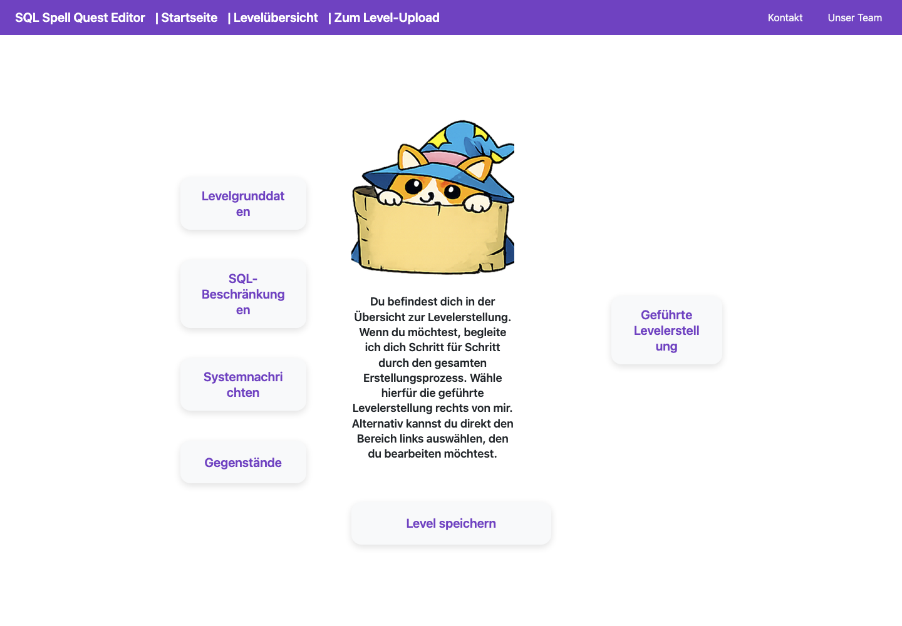

# Geführter Editor, Shortcuts und Speichern

## Wann verwende ich den geführten Editor?

Wenn du ein neues Level aufbauen möchtest. Er führt dich nacheinander durch
Grunddaten, SQL-Beschränkungen und die Erstellung der Gegenstände. Beim Einstieg
wird ein neuer Levelentwurf angelegt. Verwende ihn deshalb nicht als Einstieg,
um ein bereits vorhandenes Level weiterzubearbeiten.

## Wann verwende ich die Shortcuts?

Wenn du einen bestimmten Bereich direkt ändern möchtest. Öffne ein vorhandenes
Level über seine Bearbeiten-Aktion in der Levelübersicht. Auf der Auswahlseite
kannst du dann gezielt einen Bereich öffnen:

| Einstieg | Was du dort änderst |
|---|---|
| Levelgrunddaten | Levelname, Hintergrundbild und Begrüßung |
| SQL-Grunddaten | Höchstzahl der Ergebniszeilen/-spalten und zugehörige Meldungen |
| Systemnachrichten | Gemeinsame Nachrichten des ganzen Spiels |
| Gegenstandsverwaltung | Gegenstände bearbeiten, hinzufügen oder löschen |

Die drei Grunddaten-/Nachrichtenseiten sind die Shortcuts. Die
Gegenstandsverwaltung ist ein weiterer direkter Einstieg. Beide Wege verwenden
bestehende Editorfunktionen; du musst nicht jedes Mal alle Schritte durchlaufen.


[](images/editor/shortcuts.png)

*Die Auswahlseite nach dem Öffnen eines vorhandenen Levels. Links liegen die direkten Bearbeitungswege. Zum Vergrößern das Bild anklicken.*

## Warum verändert eine Systemnachricht mehrere Level?

Systemnachrichten gehören zum Spiel, nicht zum einzelnen Level. Die
SQL-Beschränkungen und ihre Meldungen gehören dagegen zum jeweiligen Level.

## Was ist ein Entwurf?

Ein Entwurf enthält die Daten, die du gerade bearbeitest. Der Editor hält ihn in
der **Session**, also dem Zustand deiner aktuellen Browsersitzung. Tabellenzeilen
werden zusätzlich in einem Arbeitsverzeichnis zwischengespeichert.

Ein neuer Aufruf des geführten Editors, ein neues Spiel oder ein Import kann den
Arbeitszustand ersetzen. Ungesendete Formularwerte werden durch bloßes Anklicken
eines Links nicht automatisch gespeichert. Übermittle den jeweiligen Schritt mit
dem vorgesehenen Weiter-/Speichern-Button.

## Was ist der Unterschied zwischen Speichern und Exportieren?

| Aktion | Ergebnis |
|---|---|
| Formular übermitteln | Übernimmt die Werte des betreffenden Schritts |
| Gegenstand speichern | Übernimmt den bearbeiteten Gegenstand in den Levelentwurf |
| Level speichern | Übernimmt den Levelentwurf ins aktuelle Spiel |
| Spiel exportieren | Lädt ein ZIP mit dem aktuellen Spiel herunter |

Der geführte Abschluss kann Gegenstände und Level bereits in den aktuellen
Spielzustand übernehmen. Schließe die Arbeit trotzdem über die vorgesehenen
Speicheraktionen ab und prüfe die Levelübersicht vor dem Export.
Systemnachrichten werden direkt auf Spielebene gespeichert. Es gibt keinen
allgemeinen Rückgängig-Knopf für sämtliche Änderungen am Spiel.

## Was verwirft „Bearbeitung abbrechen“?

Bei einer Gegenstandsbearbeitung werden die Änderungen dieses Gegenstandsentwurfs
verworfen. Das gilt auch für noch nicht übernommene Tabellenzeilen. Bereits vorher
gespeicherte Änderungen oder Systemnachrichten werden dadurch nicht zurückgesetzt.
Verwechsle diese Aktion nicht mit dem Zurück-Button des Browsers.

## Wie lade ich einen Export wieder?

Entpacke die ZIP-Datei. Wähle auf der Startseite den kompletten Spielordner aus,
der `SQLSpellQuest.json` und die Level-Unterordner enthält. Lade nicht nur die
JSON-Datei, wenn dazu Datenbanken oder Bilder gehören.

Ein Export sieht beispielsweise so aus:

```text
SQLSpellQuest.json
Arbeitszimmer/
  databases/Arbeitszimmer.db
  assets/hintergrund.png
  assets/notiz.png
```

Der Export ist die dauerhafte Übergabe. Verlasse dich für eine spätere Sitzung
nicht auf die Session oder temporäre Dateien des laufenden Editors.

## Gibt es einen vollständigen Durchlauf mit Bildern?

Die Anleitung [Geführter Level-Editor: Schritt für Schritt](gefuehrter-editor.md)
zeigt alle Stationen einschließlich Tabelle, Hinweis, Ausgang und Passwort-Unterseiten.
