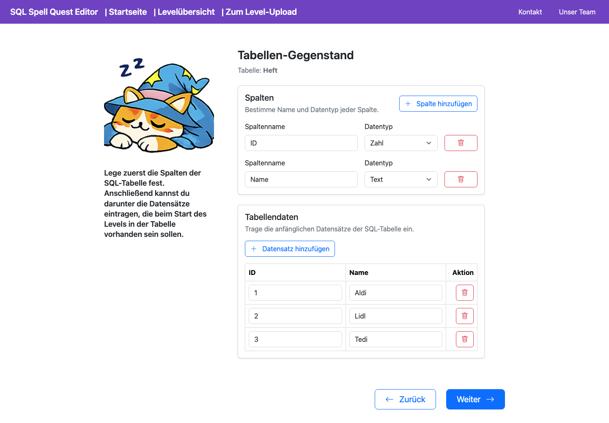

# Wie dokumentiere ich Änderungen am Projekt?

## Welche Seite sollte ich aktualisieren?

Suche zuerst nach dem Thema in der MkDocs-Suche oder im Ordner `docs/`.
Ergänze eine vorhandene Seite, wenn sie dieselbe Frage bereits beantwortet.

| Was ändert sich? | Wo dokumentiere ich es? |
|---|---|
| Ein Button, ein Shortcut oder ein Schritt im Editor | [Bedienung](bedienen.md), bei Änderungen am Ablauf auch [Mein erstes Level](erstes-level.md) |
| Ein Dateipfad oder eine Funktion, bei der andere mit einer Änderung anfangen | [Code-FAQ](code-faq.md) |
| Anleitung zum Ergänzen eines Buttons oder einer Seite | [Button und neue Seite ergänzen](seiten-erweitern.md) |
| Zuständigkeit eines Moduls oder der Weg vom Formular zur Verarbeitung | [Architektur](architektur.md) und bei Bedarf die dort verlinkte UML-Quelle |
| Ein URL-Name, Formularfeld, Session-Schlüssel oder Exportformat | [Datenverträge](editor-vertraege.md) |
| Ein Startbefehl, eine Abhängigkeit oder ein typischer Prüfweg | [Projekt starten](starten.md) oder [Testen und Fehler finden](testen.md) |

Beispiel: Wenn sich der SQL-Shortcut im Browser anders bedienen lässt,
aktualisiere die Bedienungsanleitung. Wenn sich zusätzlich ein Feld im
exportierten JSON ändert, beschreibe es auch in den Datenverträgen.

## Wie schreibe ich einen verständlichen Eintrag?

1. Formuliere die Überschrift als Frage, etwa „Wo ändere ich die SQL-Beschränkungen?“.
2. Gib die kurze Antwort im ersten Satz. Nenne für eine Codeänderung den Pfad
   ab dem Projektordner und den Funktionsnamen. Bei einer Bedienungsanleitung
   nenne den Einstieg und die sichtbaren Buttontexte.
3. Beschreibe einen kurzen Ablauf mit einem erwarteten Ergebnis. Erkläre neue
   Begriffe bei ihrer ersten Verwendung.
4. Verlinke auf vorhandene Details. Prüfe die genannten Namen und das Verhalten
   am aktuellen Code oder im laufenden Editor.

Eine kurze Antwort für die Code-FAQ könnte so aussehen:

> Die Eingaben für SQL-Beschränkungen verarbeitet `query_restriction_from_post`
> in `backend/editor/services/level_service.py`. Die Funktion wird vom geführten
> Editor und vom SQL-Shortcut verwendet. Prüfe nach einer Änderung beide Wege:
> Speichere beispielsweise eine Zeilengrenze von 5 und öffne das Formular erneut.
> Es soll wieder 5 anzeigen.

## Wie lege ich eine neue Seite an?

1. Lege im passenden Ordner unter `docs/` eine Markdown-Datei an, zum Beispiel
   `docs/tabellen-bearbeiten.md`. Beginne mit einer Hauptüberschrift.
2. Ergänze einen Eintrag unter `nav:` in `mkdocs.yml`, wenn die Seite im
   Seitenmenü erscheinen soll. Unter **Code ändern** könnte zum Beispiel
   `- Tabellen bearbeiten: tabellen-bearbeiten.md` stehen. Der Pfad im Menü
   beginnt innerhalb von `docs/`.
3. Verlinke die neue Seite aus der passenden Anleitung. In einer Markdown-Datei
   neben der neuen Seite lautet der Link etwa
   `[Tabellen bearbeiten](tabellen-bearbeiten.md)`. In einem Unterordner
   führt `../` eine Ebene nach oben.

## Wie prüfe ich die Doku vor dem Commit?

Öffne das Terminal im Projektordner mit aktivierter Python-Umgebung.
[Startanleitung für MkDocs](starten.md#wie-starte-ich-nur-die-dokumentation)

```bash
python -m pip install -r requirements-docs.txt
python -m mkdocs serve -a 127.0.0.1:8001
```

Öffne <http://127.0.0.1:8001/> und suche nach deiner Frage. Prüfe, ob der
Menüeintrag und die Links funktionieren. Gehe die beschriebenen Schritte
einmal durch und vergleiche das Ergebnis mit der Anleitung.

Starte anschließend in einem zweiten Terminal oder nach dem Beenden der
Vorschau den strikten Build:

```bash
python -m mkdocs build --strict
```

Der Build erzeugt HTML unter `site/` und bricht bei MkDocs-Warnungen ab.
Für den Commit gehören die bearbeiteten Markdown-Quellen, gegebenenfalls
Bilder oder UML-Quellen und eine geänderte Navigation in die Versionsverwaltung.
Die HTML-Dateien werden aus diesen Quellen erzeugt.


## Wie ergänze oder erneuere ich Screenshots?

Die Editor-Aufnahmen liegen unter `docs/images/editor/`. Verwende für neue
Aufnahmen ein Beispielspiel und öffne die Seite im laufenden Editor.
Die vorhandenen Screenshots wurden am 16. November 2026 mit einer
Browserbreite von 1440 Pixeln aufgenommen.

Wähle einen Ausschnitt oder eine Seitenaufnahme, auf der die besprochenen
Eingaben und Buttons gut lesbar sind. Prüfe vor dem Speichern, ob alle Bilder
geladen sind. Verwende beschreibende Dateinamen wie `table-item.png`.
Aufnahmen mit persönlichen Daten oder Zugangsdaten gehören nicht in die Doku.

Binde das Bild mit einem Alternativtext ein. Ein Link auf dieselbe Datei
ermöglicht das Öffnen in voller Größe:

```markdown
[](images/editor/table-item.png)

*Table-Item Heft aus dem Beispiellevel level1. Zum Vergrößern das Bild anklicken.*
```

Beschreibe unter dem Bild, welche Beispieldaten und welchen Bearbeitungszustand
es zeigt. Aktualisiere bei einer geänderten Oberfläche auch die betroffenen
Screenshots und überprüfe die Darstellung in der MkDocs-Vorschau.

### Screenshots des vollständigen geführten Durchlaufs

Die Aufnahmen für [den geführten Editor](gefuehrter-editor.md) liegen unter
`docs/images/editor/gefuehrter-editor/`. Die Nummern folgen der Reihenfolge der
Aufnahmen, nicht den Schrittnummern 0 bis 8 in der Anwendung. Verwende für
Aktualisierungen das dokumentierte Beispiel Arbeitszimmer mit Geschaefte, Notiz
und Tuer. Nimm die ausgefüllten Formulare vor dem Weiter-Klick auf und warte, bis
Auswahlzustände und Bilder vollständig dargestellt sind. Aktualisiere bei Änderungen
am Ablauf auch Beschreibung, Bildunterschrift und Aufnahmedatum.
