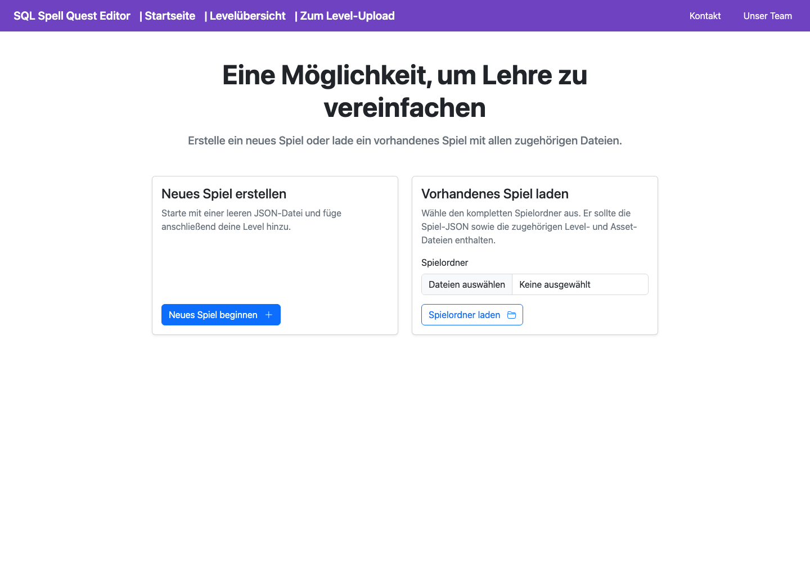
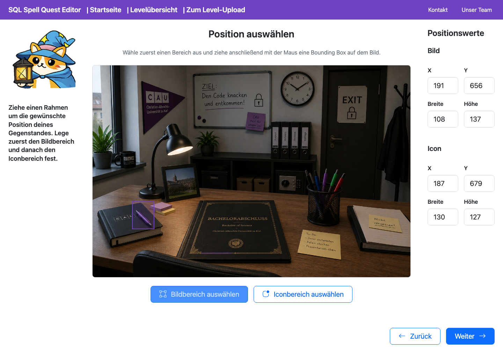

# Mein erstes Level

Diese Seite ist die Kurzfassung. Den gesamten Ablauf mit ausgefüllten Formularen
zeigt [Geführter Level-Editor: Schritt für Schritt](gefuehrter-editor.md).

**Ziel:** Ein Level `Arbeitszimmer` mit einer Tabelle, einem Hinweis und einem
Ausgang erstellen und als vollständiges ZIP herunterladen. Du brauchst ein
Hintergrundbild. Starte zuvor den [Editor](starten.md).

## 1. Ein neues Spiel beginnen

Wähle auf der Startseite **Neues Spiel beginnen**. Öffne in der Levelübersicht
**Erstelle ein neues Level** und auf der Auswahlseite **Geführte Levelerstellung**.
Damit beginnst du einen neuen Entwurf.

*Die Startseite bietet die Erstellung eines neuen Spiels und den Import eines Spielordners. Zum Vergrößern das Bild anklicken.*

## 2. Levelgrunddaten ausfüllen

Trage `Arbeitszimmer` als Namen ein, wähle dein Hintergrundbild und ergänze eine
Begrüßung wie „Willkommen im Arbeitszimmer!“. Gehe mit **Weiter** zur nächsten
Seite. Der Datenbankname wird aus dem Levelnamen gebildet.

## 3. SQL-Beschränkungen einstellen

Verwende für das Beispiel höchstens 5 Zeilen und 5 Spalten. Fülle auch die drei
Meldungen für zu viele Zeilen, Spalten oder beides aus. Diese Grenzen beschreiben
das erlaubte SQL-Ergebnis, nicht die Größe der Tabelle, die du anlegst.

## 4. Eine Tabelle als Gegenstand erstellen

Gehe zur Typauswahl und wähle **Table**. Lege diese Spalten an:

| Spaltenname | Typ |
|---|---|
| ID | Zahl |
| Name | Text |

Füge zwei Zeilen ein: `1 / Aldi` und `2 / Lidl`. Im folgenden Grunddatenschritt
nennst du den Gegenstand `Geschaefte`. Lasse die Voraussetzungen zunächst leer.
Der Tabellenname folgt dem Gegenstandsnamen.

## 5. Position und Freischaltung festlegen

Markiere auf dem Hintergrundbild einen Bildbereich und einen Iconbereich.
Wähle für den ersten Versuch **kein Passwort**. Kontrolliere die Zusammenfassung
und gehe weiter. Wähle anschließend **Weiteren Gegenstand erstellen**.

*Die Positionsauswahl am mitgelieferten Beispiellevel level1. Das Rechteck zeigt den ausgewählten Bildbereich. Zum Vergrößern das Bild anklicken.*

## 6. Einen Hinweis ergänzen

Wähle **Hint**, anschließend die Textvariante. Schreibe zum Beispiel:
„Suche den Namen des Geschäfts mit ID 2.“ Nenne den Gegenstand `Notiz`.
Markiere wieder beide Bereiche und lasse das Passwort zunächst ausgeschaltet.
Schließe den Gegenstand ab und erstelle einen weiteren.

## 7. Einen Ausgang ergänzen

Wähle **Exit**, trage eine Erfolgsmeldung ein und nenne ihn später `Tuer`.
Das aktuelle Exit-Formular enthält die Erfolgsmeldung; ein Feld für ein nächstes
Level wird hier nicht angezeigt. Prüfe das Verhalten des Ausgangs anschließend
in der Spielanwendung.

Optional: Aktiviere für die Tür ein Passwort, beispielsweise `Lidl`, und trage
einen passenden Passworthinweis ein. Hinweise nach Fehlversuchen kannst du für
den ersten Durchlauf ausgeschaltet lassen. Der Editor prüft nicht automatisch,
ob dein Passwort zur SQL-Aufgabe passt.

## 8. Level speichern und Spiel exportieren

Wähle nach dem letzten Gegenstand **Zur Auswahl der Level-Optionen** und dort
**Level speichern**. In der Levelübersicht muss `Arbeitszimmer` erscheinen.
Wähle **Exportiere das Spiel** und bewahre das ZIP auf.

## 9. Ergebnis kontrollieren

1. Entpacke das ZIP in einen separaten Ordner.
2. Prüfe, ob `SQLSpellQuest.json`, `Arbeitszimmer/databases/Arbeitszimmer.db` und
   das Hintergrundbild unter `Arbeitszimmer/assets/` vorhanden sind.
3. Lade diesen Ordner über die Startseite wieder in den Editor.
4. Öffne das Level und überprüfe Gegenstände, Tabellenzeilen und Positionen.
5. Prüfe das Rätsel anschließend im Spiel: Sind die Daten erreichbar, die
   Hinweise verständlich und die vorgesehenen Übergänge korrekt?

Für eine spätere Änderung musst du das Tutorial nicht wiederholen:
Nutze die [Bearbeitung über Shortcuts](bedienen.md).
