# Geführter Level-Editor: Schritt für Schritt

Hier gehst du den gesamten geführten Editor mit einem kleinen Beispiel durch.
Die Screenshots zeigen einen echten Durchlauf mit dem Level **Arbeitszimmer**.
Am Ende enthält es drei Gegenstände und lässt sich als ZIP exportieren.

## Was brauche ich, bevor ich anfange?

Starte den Editor nach der [Startanleitung](starten.md) und öffne ihn im Browser.
Du brauchst ein Hintergrundbild. Für dieselbe Ansicht wie in dieser Anleitung
verwende die mitgelieferte Datei:

```text
backend/editor/tests/data/SQLSpellQuest_export-24/level1/assets/bachelor_TJ3YGDP.png
```

Du kannst auch ein eigenes Bild verwenden. Dann wählst du später andere
Bildbereiche; die Koordinaten aus den Screenshots musst du nicht abschreiben.

| Gegenstand | Typ | Aufgabe im Beispiel |
|---|---|---|
| `Geschaefte` | Table | Tabelle mit den Geschäften Aldi und Lidl |
| `Notiz` | Hint | Hinweis auf die gesuchte Tabellenzeile |
| `Tuer` | Exit | Ausgang mit dem Passwort `Lidl` |

Die Zahlen 0 bis 8 oben im Editor zeigen die Hauptschritte. Einige haben mehrere
Unterseiten. Beim nächsten Gegenstand wiederholst du die Schritte 3 bis 8;
Levelname und SQL-Grenzen bleiben dabei erhalten.

## 1. Ein neues Spiel beginnen und den Assistenten öffnen

Klicke auf der Startseite auf **Neues Spiel beginnen**. Damit startest du ein
leeres Spiel. Exportiere ein bisher bearbeitetes Spiel vorher, wenn du es behalten
möchtest.

[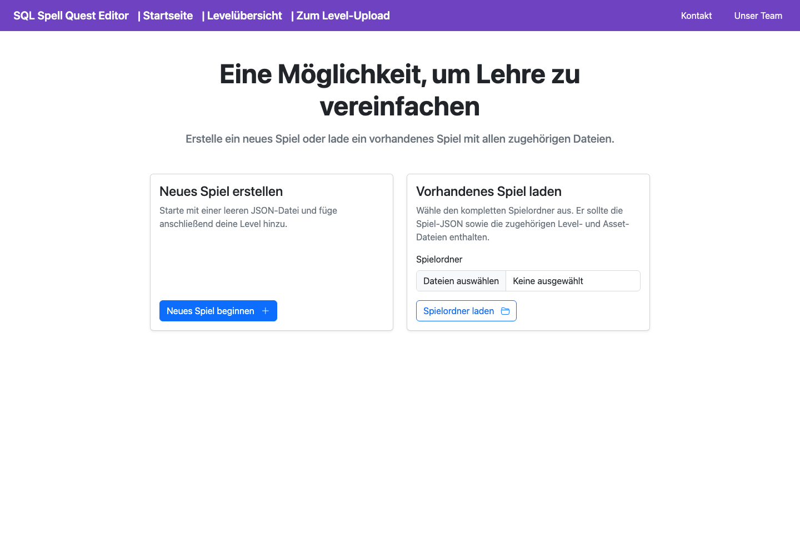](images/editor/gefuehrter-editor/01-start.png)

*Startseite mit dem Button Neues Spiel beginnen. Zum Vergrößern anklicken.*

In der anschließenden Levelübersicht klickst du auf **Erstelle ein neues Level**.
Auf der Auswahlseite wählst du **Geführte Levelerstellung**. Die anderen Buttons
sind die Shortcuts; für diesen Durchlauf brauchst du sie zunächst nicht.

[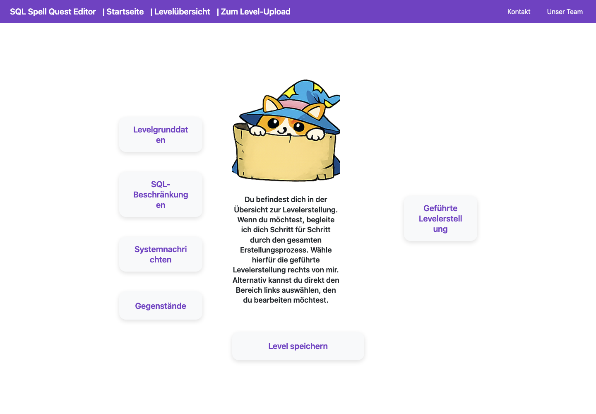](images/editor/gefuehrter-editor/02-auswahl.png)

*Auswahlseite mit dem Einstieg Geführte Levelerstellung. Zum Vergrößern anklicken.*

Cosmo begrüßt dich. Klicke auf **Start**. Jetzt öffnet sich das Formular für die
Levelgrunddaten. Der Aufruf der geführten Levelerstellung beginnt einen neuen
Entwurf; benutze ihn nicht als Rücksprung während einer laufenden Bearbeitung.

[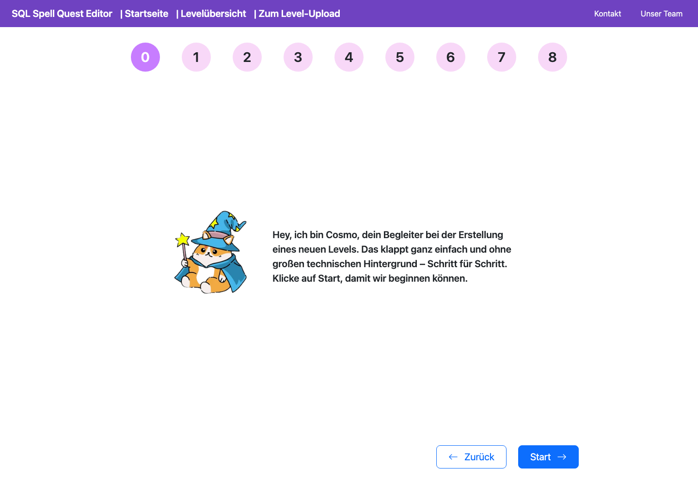](images/editor/gefuehrter-editor/03-begruessung.png)

*Begrüßung des geführten Editors bei Schritt 0. Zum Vergrößern anklicken.*

## 2. Levelgrunddaten eingeben — Schritt 1

Fülle die Felder so aus:

| Eingabe | Beispiel |
|---|---|
| Name des Levels | `Arbeitszimmer` |
| Hintergrundbild | `bachelor_TJ3YGDP.png` oder dein eigenes Bild |
| Begrüßung | `Willkommen im Arbeitszimmer! Finde heraus, welches Geschäft die ID 2 hat.` |

Wähle das Bild über **Eigenes Bild auswählen** aus. Nach der Auswahl erscheint der
Dateiname. Klicke auf **Weiter**. Du solltest zur SQL-Anzeigebegrenzung gelangen.
Der Datenbankname wird später aus dem Levelnamen gebildet: `Arbeitszimmer.db`.

[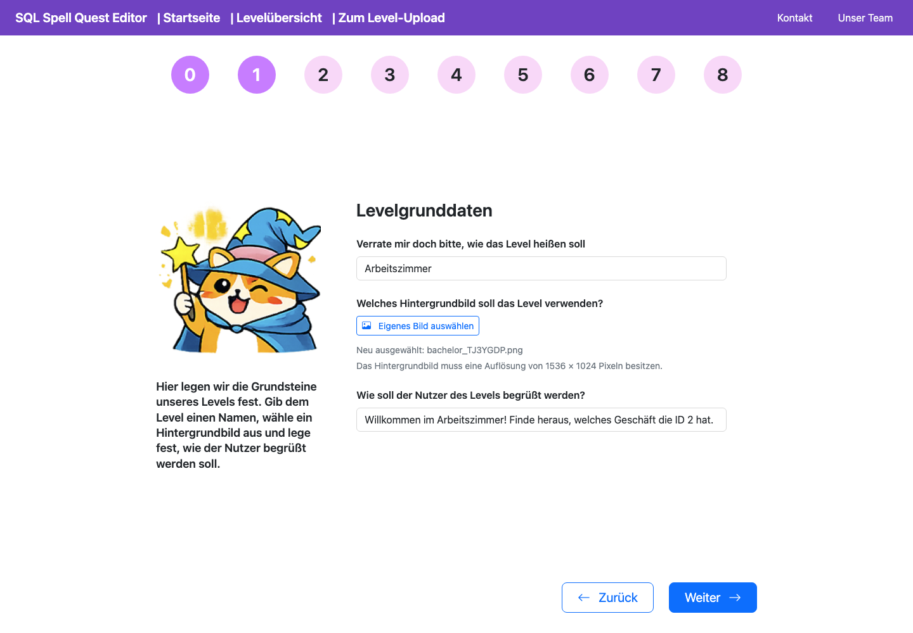](images/editor/gefuehrter-editor/04-levelgrunddaten.png)

*Ausgefüllte Levelgrunddaten mit Name, Hintergrundbild und Begrüßung. Zum Vergrößern anklicken.*

## 3. SQL-Ergebnisse begrenzen — Schritt 2

Trage bei maximaler Spaltenanzahl und maximaler Zeilenanzahl jeweils **5** ein.
Ergänze die Rückmeldungen:

| Fall | Beispielmeldung |
|---|---|
| Zu viele Zeilen | Deine Abfrage liefert zu viele Zeilen. |
| Zu viele Spalten | Wähle weniger Spalten aus. |
| Zu viele Zeilen und Spalten | Wähle weniger Zeilen und Spalten aus. |

Die Grenzen betreffen die **Ergebnisse einer SQL-Abfrage im Spiel**. Sie legen
nicht fest, wie viele Zeilen du im Tabelleneditor anlegen darfst.
Klicke auf **Weiter**. Nun beginnt die Erstellung des ersten Gegenstands.

[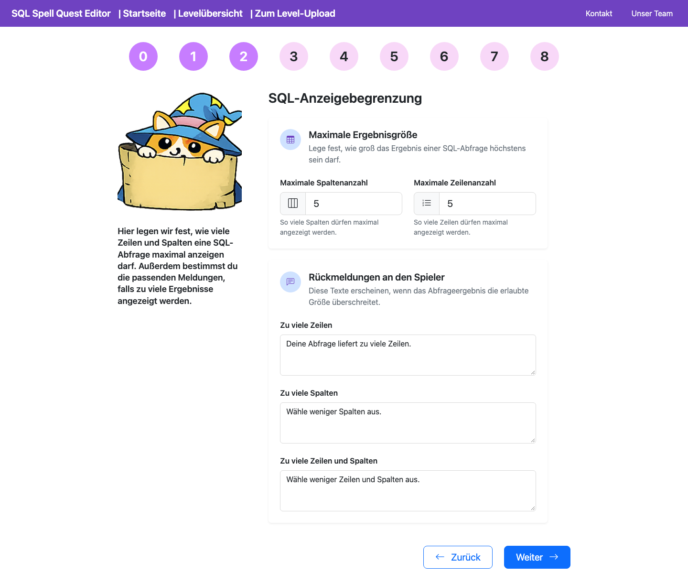](images/editor/gefuehrter-editor/05-sql-beschraenkungen.png)

*SQL-Grenzen mit jeweils fünf Zeilen und Spalten sowie drei Rückmeldungen. Zum Vergrößern anklicken.*

## 4. Den ersten Gegenstand beginnen und Table auswählen — Schritt 3

Die erste Seite erklärt, dass ein Gegenstand eine Tabelle, ein Hinweis oder ein
Ausgang sein kann. Klicke auf **Weiter**, um die eigentliche Typauswahl zu öffnen.

[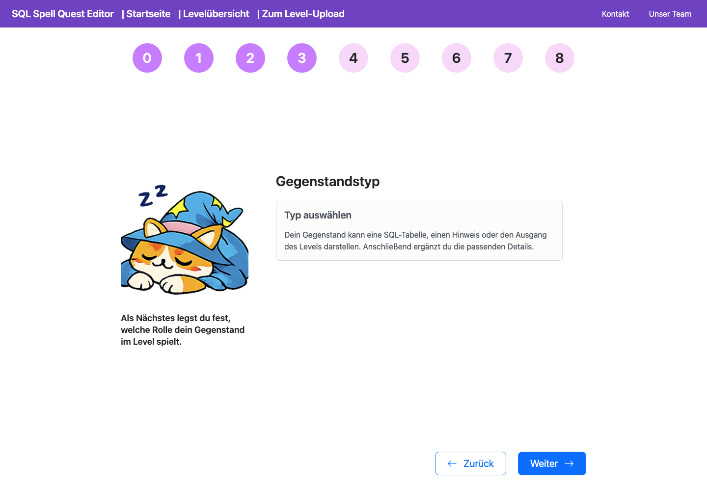](images/editor/gefuehrter-editor/06-gegenstand-start.png)

*Einführung in die Auswahl eines Gegenstandstyps. Zum Vergrößern anklicken.*

Wähle **Table** und klicke auf **Weiter**. Danach erscheint der Tabelleneditor.
Die Varianten **Hint** und **Exit** verwenden wir weiter unten.

[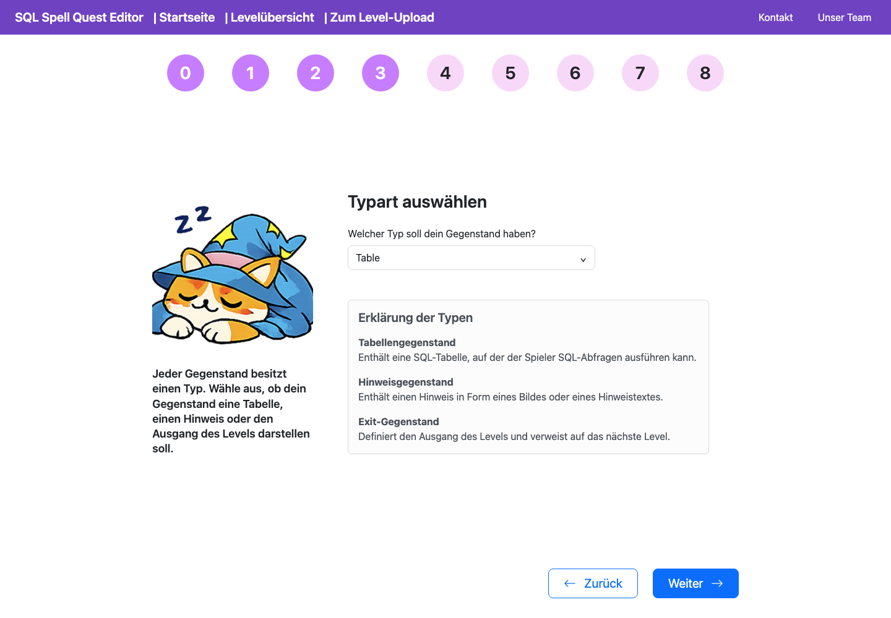](images/editor/gefuehrter-editor/07-typwahl.png)

*Typauswahl mit ausgewähltem Table-Gegenstand. Zum Vergrößern anklicken.*

## 5. Spalten und Daten der Tabelle anlegen — Unterseite von Schritt 3

Lege zuerst die Spalten an. Für die zweite Spalte klickst du auf
**Spalte hinzufügen**.

| Spaltenname | Datentyp |
|---|---|
| `ID` | Zahl |
| `Name` | Text |

Klicke zweimal auf **Datensatz hinzufügen** und fülle die Zeilen aus:

| ID | Name |
|---|---|
| 1 | Aldi |
| 2 | Lidl |

Erst die Spalten benennen, dann die Daten eintragen. Über die Papierkorbbuttons
kannst du versehentlich ergänzte Spalten oder Datensätze entfernen.
Der Tabellenname ist hier noch leer; den Gegenstandsnamen vergibst du auf der
nächsten Seite. Klicke auf **Weiter**.

[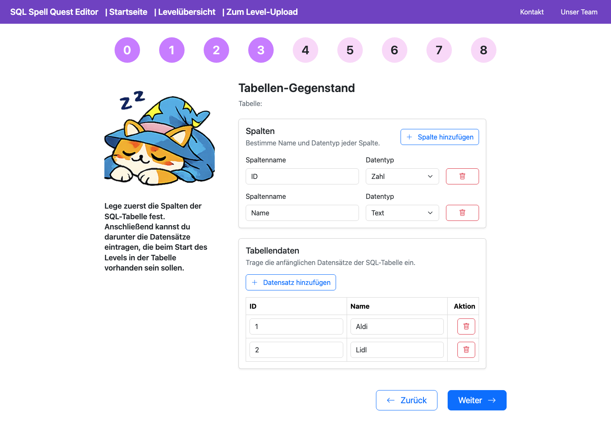](images/editor/gefuehrter-editor/08-tabelle.png)

*Tabelleneditor mit ID und Name sowie den Datensätzen Aldi und Lidl. Zum Vergrößern anklicken.*

## 6. Gegenstand benennen und Voraussetzungen wählen — Schritt 4

Nenne den Gegenstand **Geschaefte**. Bei einer Tabelle wird dieser Name auch
als Tabellenname verwendet.

Lasse die Auswahl bereits freigeschalteter Gegenstände für dieses Beispiel leer.
Solche Voraussetzungen bedeuten: Die ausgewählten Gegenstände müssen zuvor
freigeschaltet sein. Die erste Tabelle soll hier direkt zugänglich sein.
Klicke auf **Weiter**.

[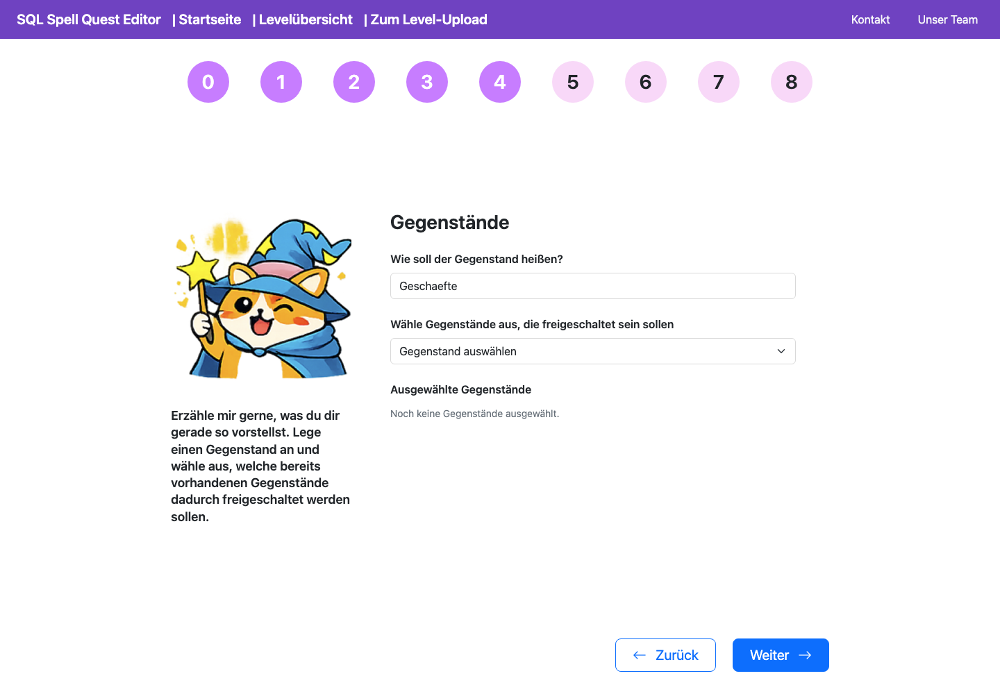](images/editor/gefuehrter-editor/09-gegenstandsgrunddaten.png)

*Grunddaten des Gegenstands Geschaefte ohne Voraussetzungen. Zum Vergrößern anklicken.*

## 7. Gegenstand auf dem Hintergrundbild platzieren — Schritt 5

Die Einstiegsseite erklärt die Positionierung. **Position anpassen** oder
**Weiter** führt zur Bereichsauswahl.

[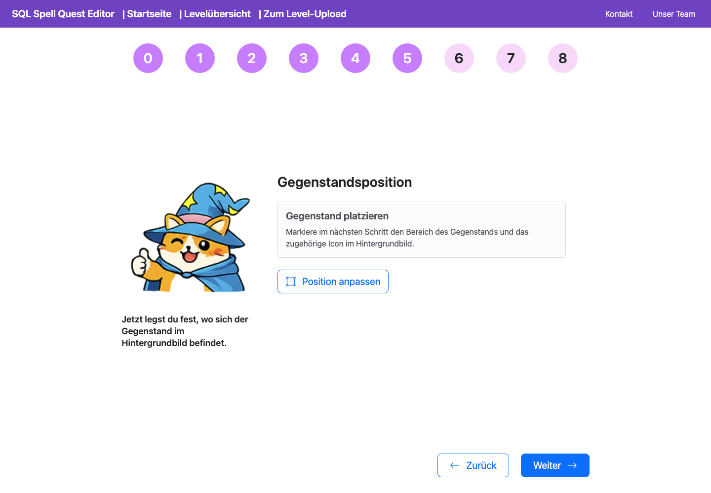](images/editor/gefuehrter-editor/10-position-einstieg.png)

*Einstieg zur Positionierung eines Gegenstands. Zum Vergrößern anklicken.*

In der Bereichsauswahl markierst du zwei Rechtecke:

1. Klicke auf **Bildbereich auswählen**. Ziehe mit gedrückter Maustaste einen
   Rahmen über den gewünschten Gegenstand im Hintergrundbild. Im Beispiel ist
   es das schwarze Buch links auf dem Schreibtisch.
2. Klicke auf **Iconbereich auswählen**. Ziehe einen kleineren Rahmen an die
   Stelle, an der das Icon des Gegenstands liegen soll.
3. Prüfe die Werte für **X**, **Y**, **Breite** und **Höhe**. Die Anwendung rechnet
   sie auf die Originalgröße des Bildes um.
4. Sobald beide Bereiche gültig sind, klicke auf **Weiter**.

Ein einzelner Klick ohne aufgezogenes Rechteck reicht nicht aus. Im Screenshot
ist zuletzt der Iconbereich markiert; die Werte des Bildbereichs bleiben rechts
sichtbar. Verwende für unterschiedliche Gegenstände unterschiedliche Positionen.

[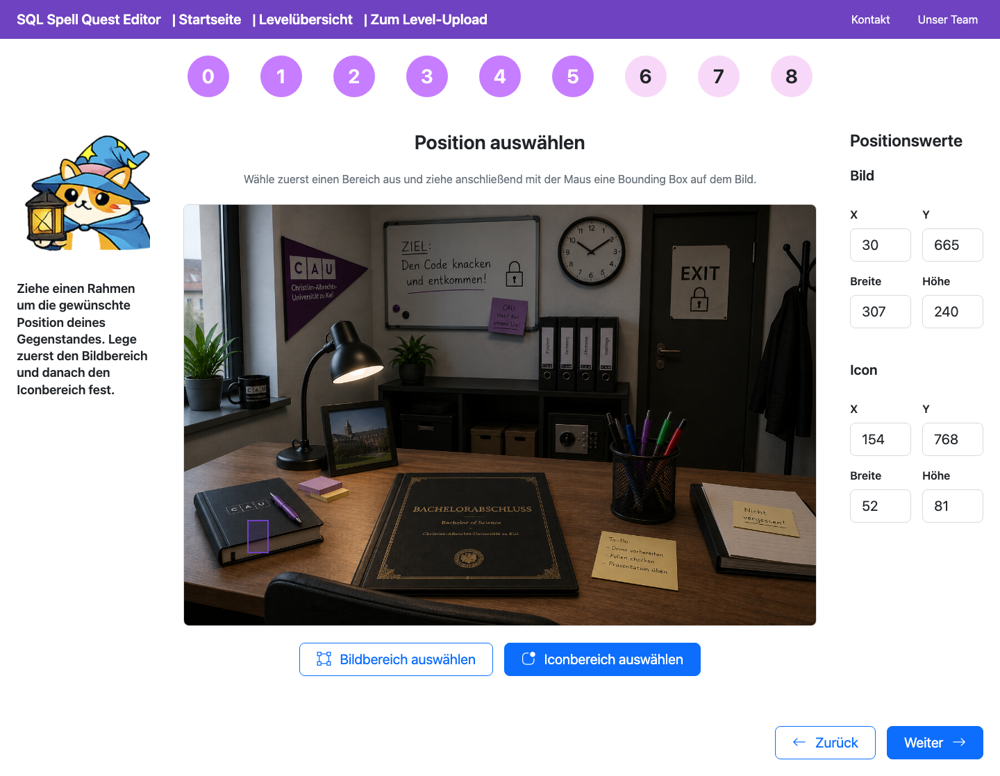](images/editor/gefuehrter-editor/11-position.png)

*Ausgewählter Bild- und Iconbereich für das Buch mit den Positionswerten rechts. Zum Vergrößern anklicken.*

## 8. Die erste Tabelle ohne Passwort freigeben — Schritt 6

Wähle bei der Passwortfrage **Nein**. Damit braucht die Tabelle kein Passwort.
Klicke auf **Weiter**; du kommst direkt zur Gegenstandsübersicht. Die beiden
Passwort-Unterseiten werden bei dieser Auswahl übersprungen.

[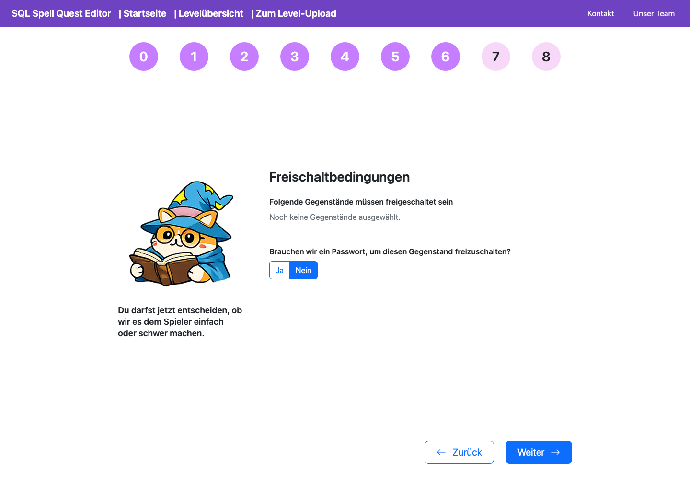](images/editor/gefuehrter-editor/12-ohne-passwort.png)

*Freischaltbedingungen mit Nein bei der Passwortfrage. Zum Vergrößern anklicken.*

## 9. Zusammenfassung kontrollieren — Schritt 7

Prüfe Typ, Tabellenname, Spalten, Gegenstandsname, Voraussetzungen, Positionen
und Passwortangaben. Bei einer Korrektur führen die Stiftsymbole in den jeweiligen
Abschnitt. Speichere dort die Änderung und kontrolliere die Übersicht erneut.

Für unsere Tabelle sollen der Typ **table**, der Name **Geschaefte**, die Spalten
**ID** und **Name** sowie **Kein Passwort** zu sehen sein. Klicke auf **Weiter**.

[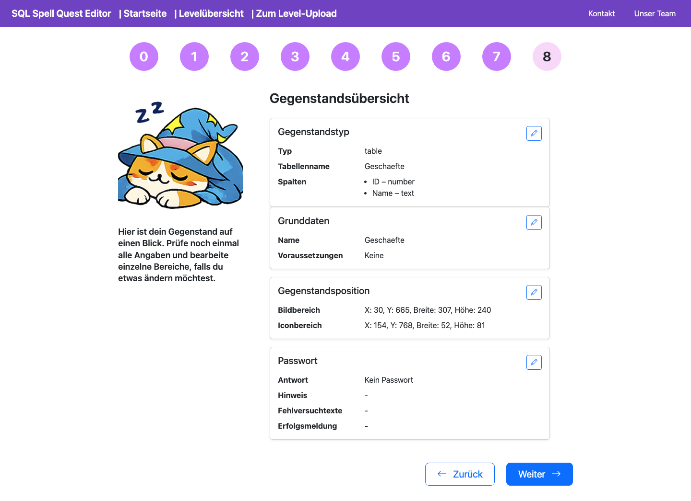](images/editor/gefuehrter-editor/13-zusammenfassung.png)

*Zusammenfassung des Tabellengegenstands Geschaefte. Zum Vergrößern anklicken.*

## 10. Gegenstand abschließen und einen weiteren beginnen — Schritt 8

Auf der Abschlussseite entscheidest du, wie es weitergeht:

| Button | Ergebnis |
|---|---|
| Weiteren Gegenstand erstellen | Übernimmt den Gegenstand und startet den nächsten bei Schritt 3 |
| Zur Gegenstandsverwaltung | Übernimmt den Gegenstand und öffnet die Gegenstandsliste |
| Zur Auswahl der Level-Optionen | Übernimmt den Gegenstand und führt zur Auswahlseite zurück |

Wähle jetzt **Weiteren Gegenstand erstellen**. Du bleibst im Level Arbeitszimmer.
Erst die Auswahl einer dieser Aktionen schließt diesen Gegenstand über die
Abschlussseite ab; die Glückwunschseite allein ist noch kein heruntergeladener Export.

[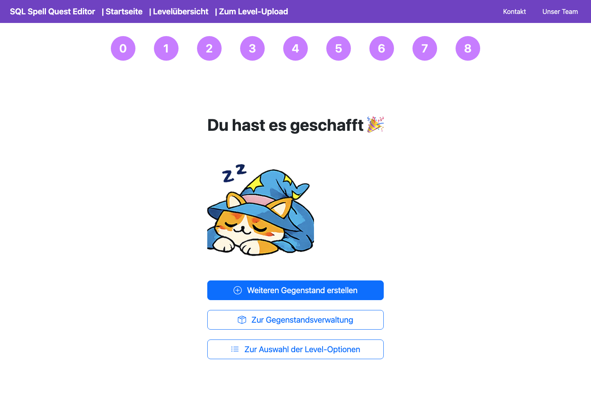](images/editor/gefuehrter-editor/14-gegenstand-fertig.png)

*Abschlussseite mit den drei Möglichkeiten zur Fortsetzung. Zum Vergrößern anklicken.*

## 11. Einen Hinweis hinzufügen — erneut Schritte 3 bis 8

Klicke auf der Einführung wieder **Weiter** und wähle bei der Typauswahl **Hint**.
Auf der Folgeseite wählst du **Über einen Text** und schreibst:

> Suche den Namen des Geschäfts mit ID 2.

Die weiteren Varianten erlauben einen Bildhinweis oder eine Kombination aus
Text und Bild. In diesem Beispiel reicht der Text.

[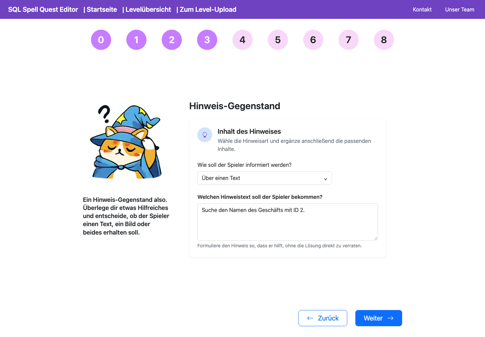](images/editor/gefuehrter-editor/15-hinweis.png)

*Hint-Gegenstand mit einem Text zur gesuchten Tabellenzeile. Zum Vergrößern anklicken.*

Danach verwendest du den bereits bekannten Ablauf:

1. **Weiter** → Name **Notiz**, keine Voraussetzungen.
2. **Weiter** → Positionierung; markiere den gelben Zettel unten rechts im Bild
   und darin einen kleinen Iconbereich.
3. **Weiter** → Passwortfrage **Nein**.
4. **Weiter** → Zusammenfassung prüfen.
5. **Weiter** → **Weiteren Gegenstand erstellen**.

Damit sind Tabelle und Hinweis angelegt. Nun folgt der Ausgang.

## 12. Einen Ausgang hinzufügen — erneut Schritt 3

Wähle diesmal **Exit**. Trage als Glückwunschnachricht ein:

> Geschafft! Du hast das Rätsel im Arbeitszimmer gelöst.

Das aktuelle Formular zeigt hier die Erfolgsmeldung. Ein Feld für ein nächstes
Level ist auf dieser Seite derzeit nicht vorhanden.

[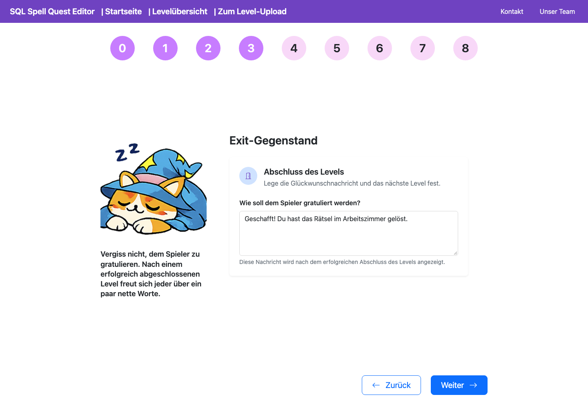](images/editor/gefuehrter-editor/16-ausgang.png)

*Exit-Gegenstand mit seiner Glückwunschnachricht. Zum Vergrößern anklicken.*

Gehe mit **Weiter** zu den Grunddaten. Nenne den Gegenstand **Tuer** und lasse
für die Übung die Voraussetzungen leer. Gehe anschließend zur Positionierung
und markiere die Tür rechts im Hintergrundbild sowie einen kleinen Iconbereich
darauf. Mit **Weiter** gelangst du zur Passwortfrage.

## 13. Den Ausgang mit einem Passwort schützen — Schritt 6

Wähle diesmal **Ja** und klicke auf **Weiter**. Jetzt öffnet sich die zusätzliche
Seite für die Passworteinstellungen.

[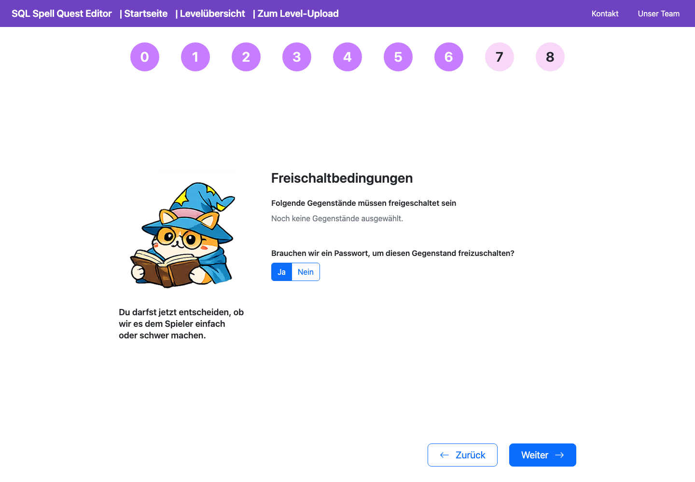](images/editor/gefuehrter-editor/17-mit-passwort.png)

*Freischaltbedingungen des Ausgangs mit aktivierter Passwortanforderung. Zum Vergrößern anklicken.*

### Passwort, Frage und Erfolgsmeldung festlegen

Fülle die Felder so aus:

| Feld | Beispiel |
|---|---|
| Frage an den Spieler | Welches Geschäft hat die ID 2? |
| Gültige Passwörter | `Lidl` |
| Nachricht nach erfolgreicher Freischaltung | Richtig! Die Tür ist jetzt offen. |
| Tipps nach falschen Passwortversuchen | Ja |

Das Passwort passt zu unserer Tabellenzeile mit ID 2. Der Editor leitet diese
Lösung nicht selbst aus der Tabelle ab; du musst Aufgabe und Antwort aufeinander
abstimmen. Klicke auf **Weiter**.

Wählst du bei den Tipps **Nein**, führt Weiter direkt zur Zusammenfassung.

[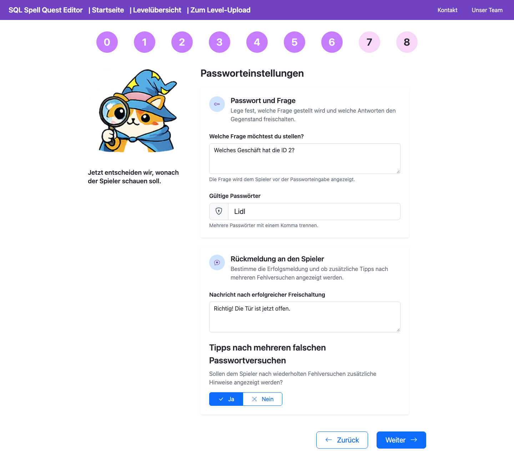](images/editor/gefuehrter-editor/18-passwortdetails.png)

*Passwortfrage mit Lidl als Antwort und aktivierten Tipps nach Fehlversuchen. Zum Vergrößern anklicken.*

### Einen Tipp nach Fehlversuchen ergänzen

In der ersten Zeile trägst du **2** und diesen Hinweis ein:

> Frage die Tabelle Geschaefte nach dem Namen zur ID 2 ab.

Das konfiguriert einen Tipp nach zwei Fehlversuchen. Weitere Tipps kannst du mit
**Weitere Zeile hinzufügen** ergänzen. Für die Übung genügt eine Zeile.
Klicke auf **Weiter**, kontrolliere die Zusammenfassung und klicke erneut auf
**Weiter**. Auf der Abschlussseite wählst du jetzt
**Zur Auswahl der Level-Optionen**.

[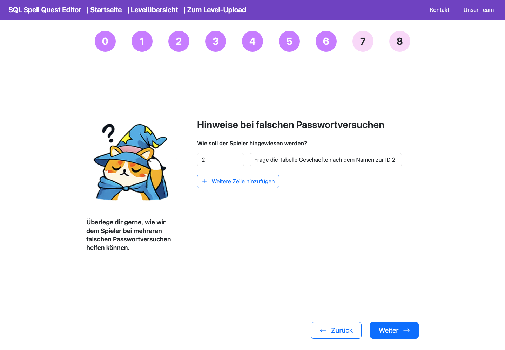](images/editor/gefuehrter-editor/19-fehlversuchshinweise.png)

*Zusätzlicher Hinweis nach zwei falschen Passwortversuchen. Zum Vergrößern anklicken.*

## 14. Das Level speichern

Du bist wieder auf der Auswahlseite. Klicke auf **Level speichern**.
Die Anwendung führt dich zur Levelübersicht zurück. Dort muss **Arbeitszimmer**
aufgelistet sein.

Über die Shortcuts könntest du an dieser Stelle einzelne Bereiche bearbeiten.
Starte die geführte Levelerstellung nicht erneut, um das fertige Level anzusehen.

[](images/editor/gefuehrter-editor/20-level-speichern.png)

*Auswahlseite mit dem Button Level speichern nach Abschluss der Gegenstände. Zum Vergrößern anklicken.*

## 15. Das Spiel exportieren und das Ergebnis kontrollieren

Klicke in der Levelübersicht auf **Exportiere das Spiel**. Der Browser lädt ein
ZIP herunter. Dieser Download ist die Datei, die du aufbewahrst und später
weitergeben oder wieder importieren kannst.

[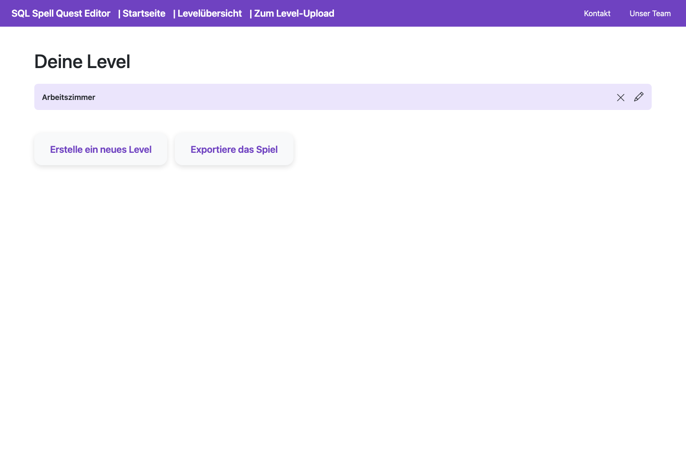](images/editor/gefuehrter-editor/21-leveluebersicht.png)

*Gespeichertes Arbeitszimmer in der Levelübersicht neben der Exportfunktion. Zum Vergrößern anklicken.*

Entpacke das ZIP in einen separaten Ordner. Darin sollten unter anderem stehen:

```text
SQLSpellQuest.json
Arbeitszimmer/
  assets/
    bachelor_TJ3YGDP.png
  databases/
    Arbeitszimmer.db
```

Bei einem eigenen Bild ist der Bilddateiname entsprechend anders. Der Export
kann weitere Dateien enthalten, beispielsweise SQL-Dateien.

Prüfe anschließend den vollständigen Weg:

1. Lade den entpackten Spielordner auf der Startseite über **Spielordner laden**.
2. Öffne Arbeitszimmer zur Bearbeitung und gehe zu **Gegenstände**.
3. Kontrolliere **Geschaefte**, **Notiz** und **Tuer**. Prüfe insbesondere die zwei
   Tabellenzeilen, den Hinweistext und die Passworteinstellungen.
4. Teste den Export im Spiel: Ist die Tabelle zugänglich? Ist der Hinweis an der
   richtigen Stelle? Lässt sich die Tür mit der vorgesehenen Antwort öffnen?

Ein erfolgreicher Editor-Export ersetzt den Spieltest nicht. Diese Anleitung
zeigt den Erstellungsablauf; die Spielanwendung entscheidet, wie die exportierten
Bedingungen und Ausgänge im Spiel ausgeführt werden.

## Was mache ich, wenn ich zurückgehen oder später etwas ändern möchte?

- Verwende die **Zurück**-Buttons im Ablauf. Noch nicht abgesendete Eingaben
  sind nicht automatisch gespeichert; **Weiter** übernimmt die Eingaben des Formulars.
- Für eine Korrektur vor Abschluss nutze die Stiftsymbole in der Zusammenfassung.
- Für Änderungen am fertigen Level nutze die [Shortcuts](bedienen.md).
- Für eine Pause mit dauerhaft gesichertem Ergebnis speichere das Level und
  exportiere das Spiel. Die aktuelle Browsersitzung allein ist keine Exportdatei.

## Wo finde ich diese Schritte im Code?

Alle folgenden Pfade liegen unter `backend/editor/`. Diese Tabelle dient als
Einstieg, wenn du nach dem Ausprobieren selbst etwas ändern möchtest.

| Bereich | Template | View-Modul |
|---|---|---|
| Begrüßung | `createLevel.html` | `view_handlers/create_level.py` |
| Levelgrunddaten | `createLevel1.html` | `view_handlers/create_level1.py` |
| SQL-Grenzen | `createLevel2.html` | `view_handlers/create_level2.py` |
| Typ und Inhalt | `createLevel3.html`, `createLevel3-1.html`, `createLevel3table.html`, `createLevel3hint.html`, `createLevel3exit.html` | `view_handlers/create_level3.py` |
| Name und Voraussetzungen | `createLevel4.html` | `view_handlers/create_level4.py` |
| Position | `createLevel5.html`, `createLevel51.html` | `view_handlers/create_level5.py` |
| Passwort und Tipps | `createLevel6.html`, `createLevel6-1.html`, `createLevel6-2.html` | `view_handlers/create_level6.py` |
| Zusammenfassung und Abschluss | `createLevel7.html`, `createLevel8.html` | `view_handlers/create_level7.py`, `view_handlers/create_level8.py` |

Die Templates liegen jeweils unter `templates/editor/`. Wie du dort einen Button
oder eine Seite ergänzen kannst, zeigt die [praktische Code-Anleitung](seiten-erweitern.md).

## Stand der Screenshots

Aufgenommen am 16. November 2026 in Chrome bei 1440 Pixeln Breite, mit einem
isolierten lokalen Editor und dem mitgelieferten Hintergrundbild. Die Formulare
zeigen den Zustand vor dem jeweiligen Weiter-Klick. Die Seitenbilder sind
unveränderte Browseraufnahmen und lassen sich durch Anklicken vergrößern.
