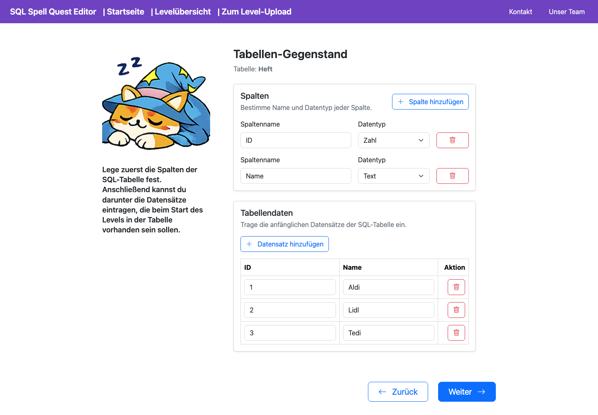
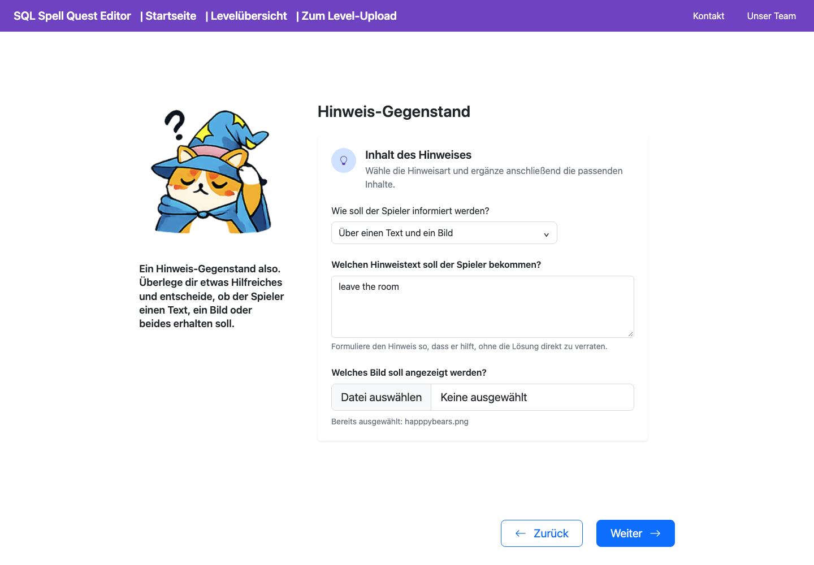
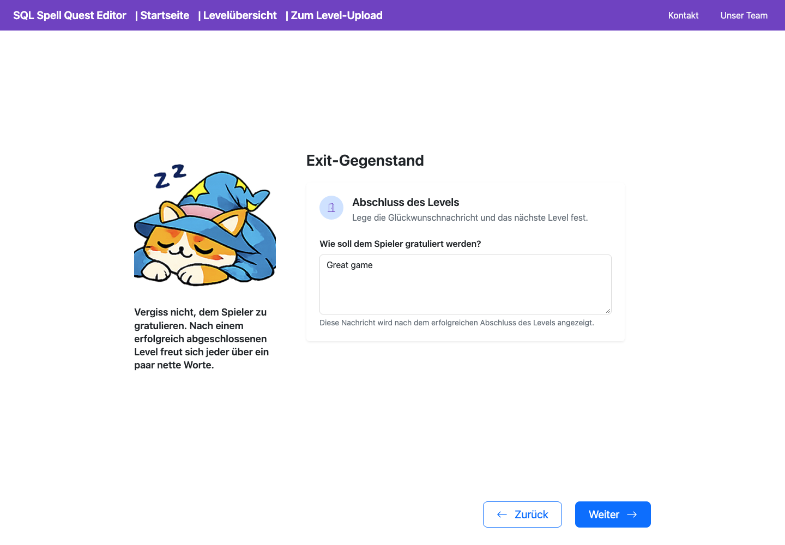

# Table-Item, Hint-Item und Exit-Item

Die Screenshots zeigen Gegenstände aus den mitgelieferten Beispieldaten
unter `backend/editor/tests/data/SQLSpellQuest_export-24/`.

## Was ist ein Table-Item?

Ein Table-Item verbindet einen Gegenstand mit einer Tabelle. Im Editor legst du
Spalten, Datentypen und Zeilen fest. Beim Export entsteht daraus eine Tabelle in
der Leveldatenbank. Im Spiel sind diese Daten für SQL-Aufgaben gedacht.

Beispiel für `Geschaefte`:

| ID (Zahl) | Name (Text) |
|---|---|
| 1 | Aldi |
| 2 | Lidl |

Eine passende SQL-Abfrage wäre `SELECT Name FROM Geschaefte;`. Ob die Tabelle im
Spiel bereits zugänglich ist, hängt zusätzlich von den Spielregeln und den
Freischaltdaten ab. Der Editor ist kein Ersatz für den anschließenden Spieltest.

**Wann verwenden?** Wenn Spieler\*innen Daten mit SQL untersuchen sollen.

*Table-Item Heft aus dem Beispiellevel level1 mit drei Datensätzen. Zum Vergrößern das Bild anklicken.*

## Was ist ein Hint-Item?

Ein Hint-Item enthält einen Hinweis. Du kannst Text, ein Bild oder beides
verwenden. Beispiel: Die Notiz „Suche nach dem Geschäft mit ID 2“ hilft bei einer
Aufgabe zur Tabelle `Geschaefte`.

**Wann verwenden?** Wenn du Informationen, Rätselhinweise oder eine Grafik als
Gegenstand bereitstellen möchtest.

Ein Hint-Item ist nicht dasselbe wie ein Hinweis nach einem falschen Passwort:
Es ist ein eigener Gegenstand. Fehlversuchhinweise sind Einstellungen an der
Passwortbedingung eines Gegenstands.

*Hint-Item Stift aus dem Beispiellevel level1 verwendet einen Text und ein Bild. Zum Vergrößern das Bild anklicken.*

## Was ist ein Exit-Item?

Ein Exit-Item beschreibt einen Ausgang. Du kannst eine Erfolgsmeldung und die ID
eines nächsten Levels hinterlegen. Beispiel: `Tuer` verweist auf `Bibliothek`.
Das Ziel muss zu deinem Spiel passen. Ein leerer Zielwert wird im Export nicht
als `nextLevelId` ausgegeben; daraus allein lässt sich kein Spielende ableiten.

**Wann verwenden?** Wenn du einen Ausgang beziehungsweise Übergang vorbereiten
möchtest. Prüfe den tatsächlichen Übergang anschließend im Spiel.

*Exit-Item Door aus dem Beispiellevel level1 mit seiner Abschlussnachricht. Zum Vergrößern das Bild anklicken.*

## Welche Einstellungen haben die Gegenstände gemeinsam?

| Einstellung | Wofür sie gedacht ist |
|---|---|
| Name | Identifiziert den Gegenstand; wird auch von Verweisen verwendet |
| Voraussetzungen | Namen anderer Gegenstände, die als Voraussetzung ausgewählt werden |
| Passwort | Optional eine oder mehrere gültige Eingaben mit Hinweis und Erfolgsmeldung |
| Fehlversuchhinweise | Zusätzliche Hinweise mit einer Anzahl falscher Versuche |
| Bildbereich und Iconbereich | Zwei Rechtecke auf dem Hintergrundbild |

Bei einer Tabelle wird der Gegenstandsname auch als Tabellenname verwendet.
Doppelte Gegenstandsnamen innerhalb eines Levels werden abgelehnt.

## Was bedeuten Bildbereich und Iconbereich?

Du markierst für beide Bereiche ein Rechteck auf dem Levelbild. Der Editor
speichert Position und Größe als `x`, `y`, `width` und `height` in Koordinaten des
Originalbilds. Die Anzeige im Browser kann kleiner sein; das JavaScript rechnet
entsprechend um. Ändere das Hintergrundbild deshalb mit Blick auf bestehende
Positionen und überprüfe die Markierungen danach.

## Was passiert, wenn ich den Typ ändere?

Der Typ bestimmt, welche Inhalte bearbeitet und exportiert werden. Beim Wechsel
von Tabelle zu einem anderen Typ räumt der Editor Tabellendaten des Entwurfs auf.
Beim Wechsel eines Hinweises auf „Text“ wird seine Bildreferenz entfernt.
Exportiere einen Zwischenstand, bevor du größere inhaltliche Umbauten machst.
